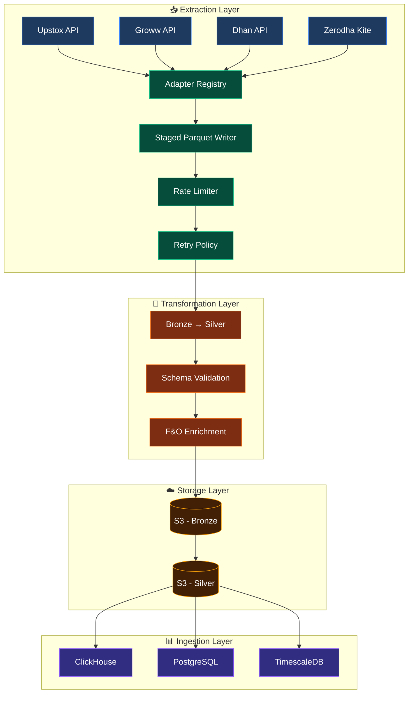

# Market Data Pipeline

**Upstox historical market data extraction platform for Indian equities, derivatives & commodities**

[](https://python.org)
[](https://pola.rs)
[](https://fastapi.tiangolo.com)
[](LICENSE)

> Built by a fintech backend engineer at Finesse Advisory Services. Fetches instruments and historical candles from the Upstox API, writes Bronze (raw) and Silver (transformed) Parquet, and ingests into ClickHouse / PostgreSQL / TimescaleDB with optional S3 push. Includes a FastAPI web UI for editing settings / broker config / `.env` / access tokens and running pipeline phases with live SSE logging.

---

## 🎯 Current State (Checkpoint: `checkpoint`)

| Capability | Status |
|------------|--------|
| **Broker** | ✅ Upstox only (adapter + parser registered) |
| **Extraction** | ✅ Master instrument + per-symbol candles, staged Parquet writes, manifest-based resume |
| **Transformation** | ✅ Bronze → Silver, equity/F&O segregation, session-bounds range filling |
| **Ingestion** | ✅ Silver → ClickHouse, PostgreSQL, TimescaleDB (date check + rollback) |
| **Cloud** | ✅ S3 push via boto3 (Bronze & Silver layers) |
| **Orchestration** | ✅ Unified pipeline (`src/pipeline/main_orchestrator.py`) |
| **Web UI** | ✅ FastAPI config editor + pipeline runner with live SSE logs (`src/api/`) |
| **Config persistence** | ✅ UI writes `settings.yaml`, `broker_config.yaml`, `access_token.json`, `.env` |
| **Gold layer** | ❌ Planned only |

---

## 🏗 System Architecture




## Data flow:

```
Upstox API (assets.upstox.com + api.upstox.com)
    │
    ▼
extraction/main.py  (DailyDataExtractor)
    │  ├── fetch master instrument (gzipped JSON)
    │  ├── fetch candles per symbol (intraday / historical / expired)
    │  └── staged Parquet writes + _manifest.parquet resume
    ▼
src/cache/upstox/Bronze/{date}/{segment}.parquet
    │
    ▼
transformation/orchestrator.py  (Bronze → Silver)
    │  ├── base_transformation
    │  ├── IntradayRangeFiller (session bounds from broker_config.yaml)
    │  ├── asset_segregation (equity CASH / fno FO)
    │  └── equity_transformation / fno_transformation
    ▼
src/cache/upstox/Silver/{date}/{segment}_{EQUITY|FNO}.parquet
    │
    ▼
ingestion/core/orchestrator.py  (Silver → DB)
    │  ├── check_date_exists (skip already-ingested dates)
    │  ├── create_table from SQL template
    │  ├── ingest parquet in batches
    │  └── delete_date_data rollback on failure
    ▼
ClickHouse / PostgreSQL / TimescaleDB

Cloud (parallel, controlled by cloud_settings.push_to_cloud):
src/cache/upstox/{Bronze|Silver}/{date}/*.parquet  →  S3 (boto3, aws adapter)
```

---

## 📁 Project Structure

```
Market_Data_Pipeline/
├── src/
│   ├── api/                              # FastAPI web UI & pipeline runner
│   │   ├── main.py                       # FastAPI app (port 8115, CORS enabled)
│   │   ├── config_routes.py              # Config editor + save endpoints
│   │   │   ├── GET/POST /api/settings        (settings.yaml)
│   │   │   ├── GET/POST /api/broker-config (broker_config.yaml)
│   │   │   ├── GET/POST /api/env             (.env)
│   │   │   ├── GET/POST /api/access-token  (access_token.json)
│   │   │   ├── cloud/db env-field endpoints
│   │   │   └── UI at /Pipelline_Dashboard  (Jinja2 + config_editor.html)
│   │   ├── pipeline_routes.py            # Pipeline execution + SSE
│   │   │   ├── POST /pipeline/run/extraction
│   │   │   ├── POST /pipeline/run/transformation
│   │   │   ├── POST /pipeline/run/cloud-push
│   │   │   ├── POST /pipeline/run/ingestion
│   │   │   ├── POST /pipeline/run/full
│   │   │   ├── POST /pipeline/run/selected
│   │   │   └── POST /pipeline/run/selected/stream  (live SSE logs)
│   │   └── templates/config_editor.html  # Dark-mode single-page UI
│   ├── extraction/
│   │   ├── main.py                 # DailyDataExtractor (entry point for extraction)
│   │   ├── clients/
│   │   │   ├── base.py             # MarketDataProvider (retry, token mgmt, session)
│   │   │   ├── registry.py         # client_registry
│   │   │   ├── register_and_discover.py
│   │   │   └── adapters/
│   │   │       └── upstox.py       # UpstoxAdapter (registered "upstox")
│   │   └── parser/
│   │       ├── base_parser.py
│   │       ├── registry.py         # parser_registry
│   │       ├── register_and_discover.py
│   │       └── adapters/
│   │           └── upstox.py       # Upstox instrument parser
│   ├── transformation/
│   │   ├── orchestrator.py         # transform_data (Bronze → Silver)
│   │   ├── clients/
│   │   │   ├── base.py             # DataTransformer
│   │   │   ├── registry.py         # transformer_registry
│   │   │   ├── register_and_discover.py
│   │   │   └── adapters/
│   │   │       └── upstox.py       # UpstoxTransformationAdapter
│   │   ├── core/
│   │   │   ├── normalizer.py
│   │   │   ├── validator.py
│   │   │   └── converter.py        # IntradayRangeFiller
│   │   └── schemas/
│   │       └── candle_schema.py
│   ├── ingestion/
│   │   ├── core/orchestrator.py    # IngestionOrchestrator (Silver → DB)
│   │   ├── clients/
│   │   │   ├── base.py             # DataIngestor
│   │   │   ├── registry.py         # ingestion_registry
│   │   │   ├── discovery.py
│   │   │   └── adapters/
│   │   │       ├── clickhouse.py
│   │   │   ├── postgresql.py
│   │   │   └── timescaledb.py
│   │   └── schemas/
│   │       ├── equity_clickhouse.sql
│   │       ├── equity_postgresql.sql
│   │       ├── fno_clickhouse.sql
│   │       └── fo_postgresql.sql
│   ├── pipeline/
│   │   └── main_orchestrator.py    # PipelineOrchestrator (all phases)
│   ├── cloud/
│   │   ├── main.py                 # CloudOrchestrator (S3 push)
│   │   ├── base.py
│   │   ├── register_and_discover.py
│   │   └── adapters/
│   │       ├── aws.py
│   │       ├── azure.py
│   │       └── gcp.py
│   ├── shared/
│   │   ├── config/
│   │   │   ├── settings.py         # get_application_settings()
│   │   │   ├── settings_model.py   # pydantic models
│   │   │   ├── settings.yaml       # single source of truth
│   │   │   ├── broker_config.yaml  # per-broker segments, session bounds, symbol mapping
│   │   │   └── access_token.json   # Upstox api_key + access_token (gitignored)
│   │   ├── observability/          # structured JSON logging
│   │   └── utils/                  # yaml_loader, registry, session_manager, utilities
│   └── cache/                      # Bronze / Silver parquet output (gitignored data)
├── pyproject.toml
├── uv.lock
├── .env                            # DB credentials (gitignored)
├── .gitignore
└── README.md
```

---

## 🚀 Quick Start

### Prerequisites
- **Python 3.11+**
- **uv** (recommended) or pip
- Upstox API credentials in `src/shared/config/access_token.json`

### Installation
```bash
cd Market_Data_Pipeline

# Using uv (recommended)
uv sync

# Or with pip
pip install -e "."
```

### Configuration (`src/shared/config/settings.yaml`)
```yaml
extractor_settings:
  client: upstox
  interval: 1
  max_retries: 3
  expiry_duration: 3
  start_date: "2026-11-23"   # empty = today (intraday)
  end_date: "2026-11-23"

ingestion_settings:
  enabled: true
  target: clickhouse          # clickhouse | postgresql | timescaledb
  batch_size: 10000
  create_tables: true
  segment_table_mapping:
    NSE_INDEX_EQUITY: ''
    NSE_FO_FNO: ''
    MCX_FO_FNO: ''
    BSE_INDEX_EQUITY: ''
    BSE_FO_FNO: ''
    BSE_EQ_EQUITY: ''
    NSE_COM_FNO: ''

cloud_settings:
  client: aws
  push_to_cloud: true
  storage_name: marketdata-pipeline
  destination_folder: market_data_storage
```

### Run the full pipeline(For daily windows cron job after setup)
```bash
# Extraction → Cloud push → Transformation → Cloud push → DB ingestion
uv run python src/pipeline/main_orchestrator.py
```

### Run extraction only (Bronze layer)
```bash
uv run python src/extraction/main.py
```

Output lands in `src/cache/upstox/Bronze/{date}/{segment}.parquet` with a `_manifest.parquet` for resume.

---

### Running with the UI (recommended)

Start the FastAPI server:

```bash
uv run python src/api/main.py
# or
uvicorn src.api.main:app --host 0.0.0.0 --port 8115 --reload
```

Open `http://localhost:8115/Pipelline_Dashboard` in your browser.

The UI lets you:

1. **Config editor** — edit `settings.yaml`, `broker_config.yaml` (segments, session bounds, symbol mapping per broker), `.env` (ClickHouse/PostgreSQL/TimescaleDB/AWS fields), and `access_token.json` (api_key + access_token). Changes are written to disk and `app_settings` is reloaded immediately.
2. **Run pipeline** — select phases (extraction → cloud push → transformation → cloud push → ingestion) and run them. Full and selected-phase runs are supported.
3. **Live logs** — the `/run/selected/stream` endpoint streams phase start/complete and log lines via SSE while phases run.

### Running from CLI (no UI)

```bash
# Full pipeline: extraction → cloud push → transform → cloud push → ingestion
uv run python src/pipeline/main_orchestrator.py
```

---

## 🔐 Credentials(Will be saved by ui when you save it for the first time)

- `src/shared/config/access_token.json` — Upstox `api_key` + `access_token` (gitignored, fill in your own)
- `.env` — ClickHouse / PostgreSQL / TimescaleDB connection strings (gitignored)

---

## 🧪 Testing & Quality

```bash
uv run ruff check src/
uv run ruff format src/
uv run mypy src/
```

> No test suite yet — planned.

---

## 🗺 Roadmap

- [ ] Groww / Dhan / Zerodha adapters (multi-broker)
- [ ] Gold layer — RSI, MACD, ATR, VWAP, regime labels, ML-ready universes
- [ ] Async extraction (aiohttp + semaphore)
- [ ] Unit/integration tests (pytest + contract tests)
- [ ] Airflow/Dagster orchestration

---

## 📄 License

MIT License — see [LICENSE](LICENSE) for details.
