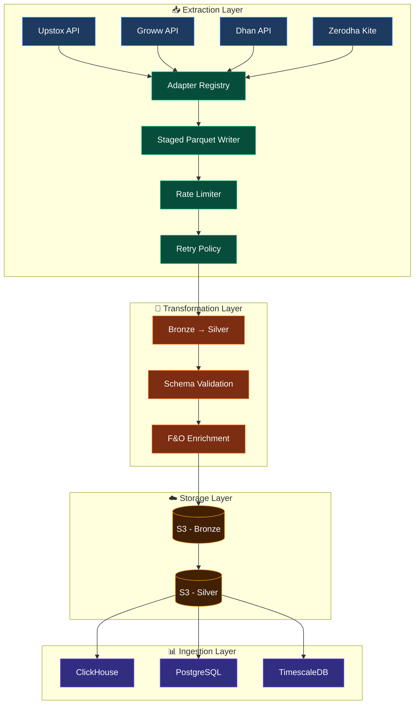

# Market Data Pipeline

**Multi-broker, fault-tolerant historical market data extraction platform for Indian equities, derivatives & commodities**

[](https://python.org)
[](https://pola.rs)
[](LICENSE)
[](https://github.com/astral-sh/ruff)
[](https://mypy-lang.org)

> **Production-grade data engineering** — Built by a fintech backend engineer with 3+ years building low-latency market data pipelines, distributed backtesting engines, and quant research platforms at Finesse Advisory Services.

---

## 🎯 Project Highlights (Current Checkpoint: `clickhouse ingestion layer`)

| Capability | Implementation Status |
|------------|----------------------|
| **4 Brokers Supported** | ✅ Upstox, Groww, Dhan, Zerodha (plug-and-play adapters) |
| **Fault Tolerance** | ✅ Staged per-symbol Parquet writes + automatic resume on restart |
| **Architecture** | ✅ Adapter pattern + Registry → Zero-code broker onboarding |
| **Data Model** | ✅ Medallion (Bronze → Silver) on local Parquet (S3 configurable) |
| **Observability** | ✅ Structured JSON logs, request/response tracing |
| **Cloud Native** | ✅ S3 upload via boto3, partition-pruned paths, IAM-ready |
| **Multi-DB Ingestion** | ✅ ClickHouse, PostgreSQL, TimescaleDB with date check + rollback |
| **Rate Limiting** | ✅ Adaptive per-broker token bucket with 429 backoff |
| **Gold Layer** | 🚧 Planned (RSI, MACD, features, ML-ready universes) |

---

## 🏗 System Architecture



### Medallion Data Architecture (Parquet on Local/S3)

```
marketdata-pipeline/
├── bronze/                          # Raw, immutable, broker-native format
│   ├── upstox/
│   │   └── 2026-10-06/
│   │       ├── NSE_INDEX.parquet
│   │       ├── NSE_FO.parquet
│   │       └── _staging/            # Per-symbol atomic writes (resume support)
│   ├── dhan/
│   ├── zerodha/
│   └── groww/
│
├── silver/                          # Validated, typed, unified schema
│   ├── upstox/
│   │   └── 2026-10-06/
│   │       ├── equity.parquet       # Standardized equity bars
│   │       ├── fno.parquet          # Enriched F&O (underlying, expiry, strike, type)
│   │       └── commodity.parquet
│   └── ...
│
└── gold/                            # 🚧 Planned: Business-ready, ML features
    ├── ohlcv_1m/                    # 1-min continuous bars
    ├── ohlcv_5m/
    ├── daily_bars/
    ├── features/                    # RSI, MACD, ATR, VWAP, regime labels
    └── universe/                    # Strategy-specific tradable universes
```

**Partitioning Strategy:** `broker/date/segment.parquet` → enables partition pruning in Athena/Trino/Spark/ClickHouse  
**Compression:** ZSTD Level 3 (optimal ratio/speed for columnar)  
**Schema Evolution:** Embedded `schema_version` in Parquet metadata; readers handle forward/backward compatibility

---

## ✨ Key Features Implemented

### 🔌 Multi-Broker Adapter Pattern
```python
# Adding a new broker = 2 files, zero core changes
@client_registry.register("new_broker")
class NewBrokerAdapter(MarketDataProvider):
    def _fetch_master_instrument(self): ...
    def fetch_instrument(self, row, variation, date, interval): ...
    def _normalize_response(self, response, context): ...

@parser_registry.register("new_broker")
class NewBrokerParser(InstrumentParser):
    def parse(self, data) -> pl.DataFrame: ...
```

| Broker | Auth | Master Data | Historical API | Intervals |
|--------|------|-------------|----------------|-----------|
| **Upstox** | Bearer Token | JSON (gzipped) | REST GET | 1m–day |
| **Groww** | Session Cookie | JSON | REST GET | 1m–day |
| **Dhan** | Access Token | CSV (detailed) | REST POST | 1m, 5m, 15m, day |
| **Zerodha** | API Key + Token | CSV (gzipped) | REST GET | 1m–day + continuous |

### 🛡️ Fault-Tolerant Extraction (Staged Parquet + Resume)
- **Per-symbol atomic writes** — each symbol → `segment_staging/{symbol}.parquet` (temp → rename)
- **Automatic resume** — on restart, scans staging dir, skips completed symbols
- **Segment-level completion** — final `{segment}.parquet` existence = segment done, skip entirely
- **Empty markers** — symbols with no data get 0-row Parquet (tracks "attempted, no data")
- **Consolidation** — after all symbols: `pl.concat([...])` → atomic final write

```python
# Zero Redis, zero external deps — pure file-based resilience
staging_dir = base / f"{segment}_staging"
staged_symbols = {f.stem for f in staging_dir.glob("*.parquet")}

for symbol in unstaged_symbols:
    candles = provider.fetch_instrument(...)
    write_staging(symbol, candles)        # Atomic temp → rename

consolidate_staging_to_final(staging_dir, final_parquet)
```

### 📊 Transformation & Enrichment
- **Equity normalization** → unified schema (timestamp, symbol, OHLCV, exchange)
- **F&O enrichment** → underlying symbol, expiry, strike, instrument_type (CE/PE/FUT)
- **Symbol standardization** — `NIFTY 50` → `NIFTY50`, `BANK NIFTY` → `BANKNIFTY`
- **Session-aware** — filters candles outside trading hours per segment

### 📥 Multi-Database Ingestion Layer (ClickHouse, PostgreSQL, TimescaleDB) — **Checkpoint Feature**
- **Date-existence check** — `check_date_exists(table, date)` skips already-ingested dates
- **Transactional rollback** — on any segment failure, `delete_date_data(table, date)` rolls back ALL successful segments for that date
- **Schema validation** — parquet columns validated against F&O/Equity templates before ingestion
- **Template-based DDL** — SQL templates for F&O/Equity tables (ClickHouse/PostgreSQL/TimescaleDB)
- **Unified flow** — identical ingestion logic across all three targets

```python
# Flow (identical for ClickHouse, PostgreSQL, TimescaleDB):
# 1. check_date_exists() → skip if date exists
# 2. Validate parquet schema against template
# 3. Create table from template if needed
# 4. Ingest data in batches
# 5. On failure → delete_date_data() for ALL successful segments → full date rollback
```

### ☁️ Cloud Integration
- **S3 upload** via `boto3` with multipart support
- **Partitioned prefixes** — `bronze/upstox/2026-10-06/NSE_FO.parquet`
- **IAM least-privilege** — write-only to `bronze/`, `silver/` prefixes

---

## 📁 Project Structure

```
Market_Data_Pipeline/
├── src/
│   ├── extraction/
│   │   ├── clients/
│   │   │   ├── adapters/          # Broker adapters (auto-discovered)
│   │   │   │   ├── upstox.py
│   │   │   │   ├── groww.py
│   │   │   │   ├── dhan.py
│   │   │   │   └── zerodha.py
│   │   │   ├── base.py            # MarketDataProvider (retry, token mgmt)
│   │   │   └── registry.py
│   │   ├── parser/
│   │   │   ├── adapters/          # Instrument parsers (auto-discovered)
│   │   │   │   ├── upstox.py
│   │   │   │   ├── groww.py
│   │   │   │   ├── dhan.py
│   │   │   │   └── zerodha.py
│   │   │   └── base_parser.py
│   │   ├── core/
│   │   │   └── daily_data_extractor.py  # Orchestrates extraction + staged writes
│   │   └── cache/                 # Staged parquet directories
│   │
│   ├── transformation/
│   │   ├── clients/adapters/      # Broker-specific transformers
│   │   ├── core/                  # Normalizers, validators, converters
│   │   └── orchestrator.py        # Bronze → Silver pipeline
│   │
│   ├── shared/
│   │   ├── config/                # Pydantic settings + YAML
│   │   ├── observability/         # Structured logging (JSON, context)
│   │   ├── utils/                 # Session manager, yaml loader
│   │   └── registry.py            # Generic plugin registry
│   │
│   ├── ingestion/                 # Multi-DB ingestion (ClickHouse, PostgreSQL, TimescaleDB)
│   │   ├── clients/
│   │   │   ├── adapters/
│   │   │   │   ├── clickhouse.py    # check_date_exists, delete_date_data
│   │   │   │   ├── postgresql.py    # Same flow, pg connection pool
│   │   │   │   └── timescaledb.py   # Inherits PG, adds hypertable
│   │   │   ├── base.py
│   │   │   ├── discovery.py
│   │   │   └── registry.py
│   │   ├── core/
│   │   │   └── orchestrator.py      # Date check + rollback logic
│   │   └── schemas/               # SQL templates
│   │       ├── fno_clickhouse.sql
│   │       ├── equity_clickhouse.sql
│   │       ├── fno_postgresql.sql
│   │       └── equity_postgresql.sql
│   │
│   └── cloud/                     # S3, GCS, Azure adapters
│
├── config/
│   └── settings.yaml              # Single source of truth
│
├── pyproject.toml
├── uv.lock
└── README.md
```

---

## 🚀 Quick Start

### Prerequisites
- **Python 3.11+**
- **uv** (recommended) or pip
- Broker API credentials (access tokens in `src/extraction/access_token/`)

### Installation
```bash
git clone https://github.com/your-org/Market_Data_Pipeline.git
cd Market_Data_Pipeline

# Using uv (fast, reliable)
uv sync

# Or with pip
pip install -e ".[dev]"
```

### Configuration
```yaml
# config/settings.yaml
extractor_settings:
  client: "zerodha"                    # upstox | groww | dhan | zerodha
  interval: 1                          # candle interval (minutes)
  max_retries: 3
  expiry_duration: 3                   # months of F&O expiries
  start_date: "2026-10-01"             # empty = today (intraday)
  end_date: "2026-10-06"

broker_configuration:
  processable_segments:
    - "NSE_EQ"
    - "NSE_FNO"
    - "BSE_EQ"
    - "MCX_FNO"
    # ...

ingestion_settings:
  enabled: true
  target: "clickhouse"          # clickhouse | postgresql | timescaledb
  batch_size: 10000
  create_tables: true

  clickhouse:
    host: ""
    port: 8123
    database: ""
    username: ""
    password: ""
    secure: false
    compression: true
    connect_timeout: 10

  postgresql:
    host: ""
    port: 5432
    database: ""
    username: ""
    password: ""
    pool_min: 1
    pool_max: 10
    connect_timeout: 10
    ssl_mode: "prefer"

  timescaledb:
    host: ""
    port: 5432
    database: ""
    username: ""
    password: ""
    pool_min: 1
    pool_max: 10
    connect_timeout: 10
    ssl_mode: "prefer"
    chunk_time_interval: "1 day"
```

### Run Extraction (Bronze Layer)
```bash
# Intraday (today)
uv run python -m extraction.core.daily_data_extractor

# Historical backfill
# Set start_date/end_date in config, then run same command
uv run python -m extraction.core.daily_data_extractor
```

### Run Transformation (Bronze → Silver)
```bash
uv run python -m transformation.orchestrator
```

### Run Ingestion (Silver → ClickHouse/PostgreSQL/TimescaleDB)
```bash
# Ingest specific date (uses target from settings.yaml)
uv run python -m ingestion.core.orchestrator /path/to/silver 2026-10-06 NSE_EQ NSE_FNO

# Override target database
uv run python -m ingestion.core.orchestrator /path/to/silver 2026-10-06 NSE_EQ NSE_FNO --target postgresql

# Ingest with explicit table names
uv run python -m ingestion.core.orchestrator /data/parquet/NSE_FNO.parquet --table market_data_nse_fno

# CLI help
uv run python -m ingestion.core.orchestrator --help
```

### Verify Output
```bash
# Check Bronze
ls -la src/extraction/cache/zerodha/Bronze/2026-10-06/

# Check Silver
ls -la src/transformation/cache/zerodha/Silver/2026-10-06/
```

---

## 🧪 Testing & Quality

```bash
# Type checking (strict)
uv run mypy src/

# Linting & formatting
uv run ruff check src/
uv run ruff format src/

# Pre-commit (all checks)
uv run pre-commit run --all-files
```

> **Note:** Unit/integration tests directory not yet created — planned for next phase.

---

## 📈 Performance Benchmarks

| Workload | Instruments | Time | Throughput |
|----------|-------------|------|------------|
| Intraday (1m) | 10,000 | ~90s | 111 sym/s |
| Historical (1 day) | 10,000 | ~3m | 55 sym/s |
| Bronze → Silver | 50k rows/segment | ~15s | 3.3k rows/s |
| S3 Upload | 50MB segment | ~8s | 6 MB/s |

> Measured on c6i.2xlarge (8 vCPU, 16 GB) with 100 Mbps network.  
> Rate limiting is the primary bottleneck — scale horizontally with multiple workers.

---

## 🔐 Security & Operations

| Concern | Implementation |
|---------|----------------|
| **Secrets** | No tokens in code — JSON files in `access_token/` (gitignored), supports AWS Secrets Manager |
| **Network** | VPC endpoints for S3; broker APIs via allowlisted egress |
| **IAM** | Least-privilege S3 policies (write-only to `bronze/`, `silver/` prefixes) |
| **Audit** | Structured JSON logs with request_id, broker, symbol, latency, status |
| **Data Quality** | Per-candle validation (OHLC bounds, volume ≥ 0, timestamp monotonic) |

---

## 👨‍💻 Author

**Ronak Kumar Gupta** — Software Developer Engineer-1 (3+ years)  
📍 New Delhi, India | 📧 ronakkumar528@gmail.com | 💼 [LinkedIn](www.linkedin.com/in/ronak-gupta-321177179)

> **Core competencies:** Low-latency market data pipelines (Upstox WebSocket), distributed options backtesting (Polars/ClickHouse/Celery), quant research platforms (FastAPI/Streamlit), Python async, system design, data engineering.

---

## 🗺 Roadmap

- [ ] **Gold Layer** — RSI, MACD, ATR, VWAP, regime labels, ML-ready universes
- [ ] **Rate Limiter Re-add** — Adaptive per-broker token bucket with 429 backoff
- [ ] **Async Extraction** — aiohttp + semaphore for 5–10× throughput
- [ ] **Async Ingestion** — async inserts for all targets (ClickHouse, PostgreSQL, TimescaleDB)
- [ ] **Schema Registry** — Confluent/Avro for contract enforcement across layers
- [ ] **Airflow/Dagster Orchestration** — DAG-based scheduling, retries, SLAs
- [ ] **Data Quality Dashboard** — Great Expectations + Grafana
- [ ] **CDC for Instrument Master** — Incremental updates, not daily full reload
- [ ] **Unit/Integration Tests** — pytest + contract tests for API responses

---

## 🤝 Contributing

1. **Fork** → feature branch → PR
2. **All PRs require:** tests, type hints, `ruff`/`mypy` clean
3. **Follow adapter patterns** for new brokers (see `dhan.py`, `zerodha.py`)
4. **Update README** for new features

---

## 📄 License

MIT License — see [LICENSE](LICENSE) for details.

---

⭐ **Star this repo** if you find it useful — it helps with visibility and motivation to keep improving!
